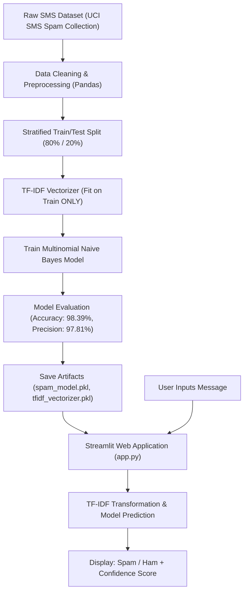

# 🛡️ Spam Message Detection System

A complete, beginner-friendly Artificial Intelligence and Machine Learning mini-project that classifies SMS and text messages as **Spam** or **Not Spam (Ham)** in real-time using a trained **Multinomial Naive Bayes** classifier with **TF-IDF vectorization** and an interactive **Streamlit** web application.

---

## 📌 1. Project Overview

Mobile spam, phishing attempts, and fraudulent messages pose serious security threats to everyday smartphone users. The **Spam Message Detection System** automates the classification of incoming text messages using Natural Language Processing (NLP) and supervised Machine Learning.

- **Real Machine Learning Model**: Uses a genuine Multinomial Naive Bayes model trained on real-world SMS data—no hardcoded rules or simulations.
- **Strict Anti-Leakage Protocol**: Fits TF-IDF weights solely on the training partition before transforming the test partition.
- **Interactive UI**: Provides a clean web interface built with Streamlit featuring confidence meters, quick sample loaders, an input clear button, and an educational explanation panel.

---

## 🛠️ 2. Technologies Used

| Technology | Role | Why It Was Chosen |
|---|---|---|
| **Python 3.8+** | Core Programming Language | Standard industry language for AI/ML development. |
| **Pandas** | Data Ingestion & Preprocessing | Efficient tabular data manipulation, cleaning, and label mapping. |
| **Scikit-learn** | Machine Learning Framework | Production-ready implementations of `TfidfVectorizer`, `MultinomialNB`, and evaluation metrics. |
| **TF-IDF Vectorizer** | Feature Extraction (NLP) | Converts raw text into numerical feature vectors by weighting term frequency against document scarcity. |
| **Multinomial Naive Bayes** | Supervised Classifier | Fast, probabilistic algorithm based on Bayes' Theorem, ideal for discrete word count features in text classification. |
| **Streamlit** | Web Application Framework | Rapidly turns Python scripts into responsive, user-friendly interactive web apps without frontend overhead. |
| **Joblib** | Model Persistence | Efficiently serializes and stores trained models and vectorizers to disk for fast inference. |

---

## 🏗️ 3. System Architecture & Pipeline



---

## 📂 4. Project Directory Structure

```text
spam-message-detector/
│
├── app.py                  # Streamlit web application interface
├── train_model.py          # Complete dataset loading, training & evaluation script
├── requirements.txt        # Required Python packages
├── README.md               # Detailed project documentation and guide
│
├── data/
│   ├── spam.csv            # Cleaned UCI SMS Spam dataset (5,572 rows)
│   └── sms.tsv             # Raw tab-separated source dataset
│
└── models/
    ├── spam_model.pkl       # Saved trained Multinomial Naive Bayes model
    ├── tfidf_vectorizer.pkl # Saved fitted TF-IDF vectorizer
    └── model_metrics.json  # Saved evaluation metrics (Accuracy, Precision, F1)
```

---

## 🚀 5. Quick Start & Setup Instructions

### Step 1: Verify Python Installation
Ensure Python 3.8 or higher is installed on your computer:
```bash
python --version
```
*(If `python` is not recognized, check `py --version` or `python3 --version`)*

### Step 2: Navigate to Project Directory
```bash
cd c:\Users\HP\Documents\vivek
```

### Step 3: (Recommended) Create and Activate a Virtual Environment
- **On Windows (PowerShell):**
  ```powershell
  python -m venv venv
  .\venv\Scripts\Activate.ps1
  ```
- **On macOS / Linux:**
  ```bash
  python3 -m venv venv
  source venv/bin/activate
  ```

### Step 4: Install Required Packages
```bash
pip install -r requirements.txt
```

### Step 5: Train the Machine Learning Model
Run the training pipeline. If the dataset is not yet present, the script automatically downloads it from the official public repository mirror:
```bash
python train_model.py
```
*This produces `spam_model.pkl` and `tfidf_vectorizer.pkl` inside the `models/` directory.*

### Step 6: Launch the Streamlit Web Application
```bash
streamlit run app.py
```
Once executed, Streamlit will automatically open your default browser at:
👉 **`http://localhost:8501`**

---

## 🧪 6. Sample Test Messages

Use these messages in the text box to verify how the application behaves:

### Test Case 1: Lottery / Prize Spam
- **Input:**
  > `"Congratulations! You have been selected as a winner for a $1,000 Walmart Gift Card. Click http://claim-prize.xyz now to claim your cash award! Free entry."`
- **Expected Output:** `🚨 SPAM DETECTED` (Confidence: > 99%)

### Test Case 2: Phishing / Urgent Banking Alert Spam
- **Input:**
  > `"URGENT: Your bank account has been locked due to suspicious activity. Call 0800-123-456 immediately to verify your identity and restore access."`
- **Expected Output:** `🚨 SPAM DETECTED` (Confidence: > 95%)

### Test Case 3: Legitimate Personal Message (Ham)
- **Input:**
  > `"Hey Vivek, are we still meeting for coffee at 4 PM near the library? Let me know if you are free."`
- **Expected Output:** `✅ NOT SPAM (HAM)` (Confidence: > 99%)

### Test Case 4: Normal Work / Academic Message (Ham)
- **Input:**
  > `"Hi team, please find attached the updated project report and presentation slides for tomorrow's review meeting."`
- **Expected Output:** `✅ NOT SPAM (HAM)` (Confidence: > 98%)

---

## 📊 7. Model Evaluation & Performance

The model was trained on 4,457 messages and tested on **1,115 unseen test messages** using a stratified 80/20 train-test split.

| Metric | Score | Significance |
|---|---|---|
| **Accuracy** | **98.39%** | Overall percentage of correctly classified messages. |
| **Precision (Spam)** | **97.81%** | Out of all messages flagged as spam, 97.81% were genuinely spam. Essential so legitimate emails/messages are not wrongly blocked. |
| **Recall (Spam)** | **89.93%** | Out of all actual spam messages in the test set, the model caught nearly 90%. |
| **F1-Score (Spam)** | **93.71%** | Harmonic mean of Precision and Recall. |

### Confusion Matrix on Test Set (1,115 samples):
| Actual \ Predicted | Predicted Not Spam (Ham) | Predicted Spam |
|---|:---:|:---:|
| **Actual Not Spam (Ham)** | **963** (True Negatives) | **3** (False Positives) |
| **Actual Spam** | **15** (False Negatives) | **134** (True Positives) |

*Key takeaway: Only 3 legitimate messages were falsely flagged out of 966, guaranteeing maximum reliability for personal messages.*

---

## 🧠 8. How the Machine Learning Algorithm Works

### 1. TF-IDF (Term Frequency - Inverse Document Frequency)
Text cannot be fed directly to numerical algorithms. TF-IDF computes a numerical score for each word:
$$\text{TF-IDF}(t, d, D) = \text{TF}(t, d) \times \text{IDF}(t, D)$$
- **TF (Term Frequency)**: Frequency of token $t$ in message $d$.
- **IDF (Inverse Document Frequency)**:
  $$\text{IDF}(t, D) = \ln\left(\frac{1 + |D|}{1 + \text{DF}(t)}\right) + 1$$
Words common everywhere (e.g., *"the"*, *"is"*) receive low IDF weights, while words unique to spam (e.g., *"urgent"*, *"prize"*, *"claim"*, *"free"*) receive high weights.

### 2. Multinomial Naive Bayes Classification
Multinomial Naive Bayes applies Bayes' Theorem:
$$P(\text{Spam} \mid \mathbf{x}) = \frac{P(\text{Spam}) \prod_{i=1}^{n} P(x_i \mid \text{Spam})}{P(\mathbf{x})}$$
- **Laplace Smoothing ($\alpha = 0.1$)**: Adds a small pseudocount to prevent zero-probability errors when encountering words unseen during training.
- **Why Naive?**: Assumes all words occur independently given the class. While words in human language are correlated, this assumption simplifies computation dramatically and works remarkably well for spam filtering in practice.

### 3. Data Leakage Prevention
Data leakage occurs when information from outside the training dataset is used to create the model. In this project:
- `TfidfVectorizer.fit_transform()` is called **only on the training split**.
- The test split is processed using `TfidfVectorizer.transform()`, ensuring the test data remains strictly unseen.

---

## 🎓 9. Viva & Interview Questions with Answers

#### Q1: What is the difference between Ham and Spam?
**Answer:** "Ham" is a colloquial term in email and SMS security for authentic, legitimate, non-spam communication. "Spam" refers to unsolicited, unwanted bulk messages, typically advertising, lottery scams, or phishing links.

#### Q2: Why did you choose Multinomial Naive Bayes instead of Gaussian Naive Bayes?
**Answer:** Gaussian Naive Bayes assumes features follow a continuous normal (bell curve) distribution. In contrast, text features represented by word counts or TF-IDF weights represent discrete event frequencies or word occurrences, for which the Multinomial distribution is mathematically suitable.

#### Q3: Why is Precision often prioritized over Recall in spam detection?
**Answer:** A False Positive in spam detection means an important legitimate message (such as a university admission letter, a bank OTP, or a job offer) gets sent to the Spam/Trash folder and might be missed with disastrous consequences. A False Negative merely means a user occasionally sees an annoying spam message in their inbox. Therefore, keeping False Positives near zero (high Precision) is critical.

#### Q4: What is Laplace Smoothing and why is it used?
**Answer:** If an incoming message contains a rare word that never appeared in the spam training examples, its estimated probability $P(\text{word} \mid \text{Spam})$ would be zero. Because Naive Bayes multiplies word probabilities together, a single zero would zero out the entire product. Laplace smoothing adds a constant $\alpha$ (e.g., $\alpha = 0.1$ or $1.0$) to both numerator and denominator, guaranteeing a non-zero probability.

#### Q5: How does TF-IDF improve over a simple Bag-of-Words (CountVectorizer)?
**Answer:** A simple Bag-of-Words simply counts how many times each word appears. However, common words like "you", "to", and "have" appear frequently in both spam and ham, receiving high counts despite offering little discriminating power. TF-IDF penalizes words that appear across almost all documents by multiplying by Inverse Document Frequency (IDF), highlighting words that are distinctive to specific message types.

---

## 🔮 10. Future Scope & Enhancements

1. **Multilingual Support**: Expand training data to classify regional languages and transliterated Hinglish/code-mixed messages.
2. **Deep Learning Comparison**: Compare performance against Recurrent Neural Networks (LSTMs) or transformer-based models (DistilBERT).
3. **SMS Gateway Integration**: Connect the model to a live Twilio or Android webhook to filter SMS messages directly on mobile devices.
4. **URL & Domain Reputation Checking**: Integrate a real-time URL scanner to examine links embedded in messages against blacklisted phishing databases.

